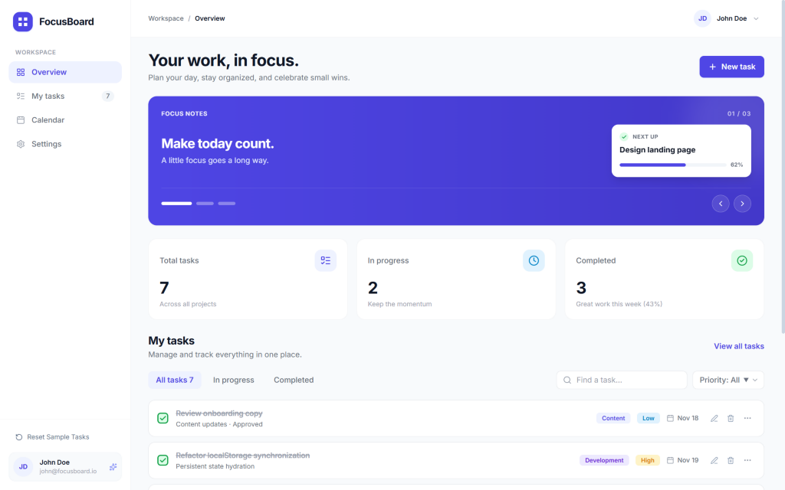
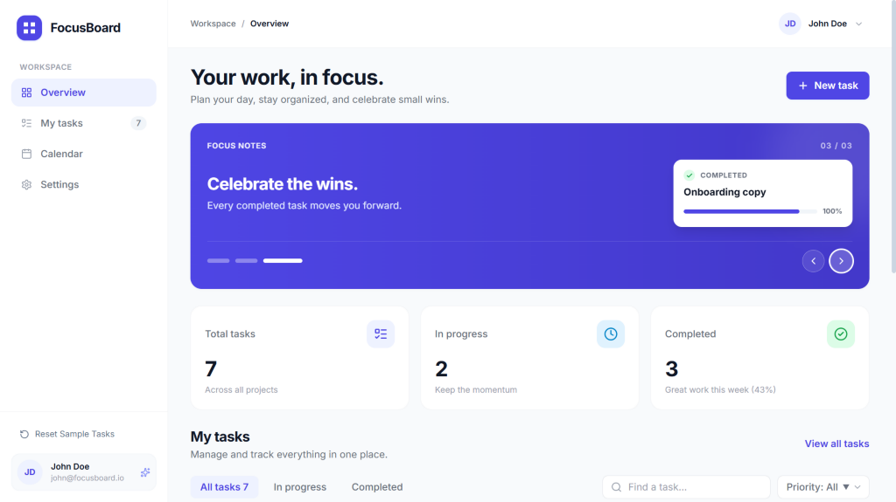

# FocusBoard — Dashboard Candidate Assignment

A responsive, pixel-perfect task management dashboard developed for the **FocusBoard Trainee Assessment (24 Hours)** based on the official [Figma Reference File](https://www.figma.com/design/09TveHXjOvI73KDNndCFM4/FocusBoard-%E2%80%94-Dashboard-References?node-id=0-1&p=f).

---

## 📋 Final Submission Template

- **Candidate**: Anjaiah Siddam (Anji0522)
- **Framework**: React 19 + TypeScript + Vite + Tailwind CSS
- **Hosting URL**: [https://focusboard-dashboard.vercel.app](https://focusboard-dashboard.vercel.app)
- **GitHub Source**: [https://github.com/Anji0522/focusboard-dashboard](https://github.com/Anji0522/focusboard-dashboard)
- **Notes / Pending Work**: Fully functional single-user dashboard delivered. All acceptance criteria, carousel slides, modal validations, local storage persistence, and responsive breakpoints (390px, 768px, 1440px) verified.

---

## 📸 Screenshots

### Desktop Dashboard (1440 × 1000 px)


### Mobile Dashboard (390 × 1128 px)


---

## 🚀 Key Features & Implementation Scope

### 1. Pixel-Perfect Figma Fidelity (Figma Source: `09TveHXjOvI73KDNndCFM4`)
- **Desktop (1440 × 1000, 1:2)**:
  - Sidebar navigation with brand logo square (`#4F46E5`), `WORKSPACE` label, active `Overview` item, dynamic `My tasks` count badge, `Calendar`, `Settings`, and `John Doe` profile.
  - Page header with breadcrumbs (`Workspace / Overview`), title **"Your work, in focus."**, and `+ New task` button.
  - Overview statistics: Total tasks, In progress, Completed with derived numbers and contextual subtext.
  - Filter bar: Status tabs (`All tasks`, `In progress`, `Completed`), case-insensitive search input, and Priority dropdown.
  - Task rows: Distinct outline vs filled checkboxes, category tags (`Design`, `Development`, `Content`, `Research`), priority pills (`High`, `Medium`, `Low`), calendar due dates, direct edit & delete buttons, and options menu.
- **Mobile (390 × 1128, 1:167)**:
  - Responsive header with JD avatar and mobile `+` task creation button.
  - Stacked mobile task cards with touch targets $\ge 44\text{px}$.
  - Fixed mobile bottom navigation bar (`Overview`, `Tasks`, `Calendar`, `Settings`).

### 2. Focus Notes Carousel (Frames 15:2, 15:30, 15:58)
- Implements all **three Figma slides** with the rich Indigo gradient banner:
  - **Slide 1**: *"Make today count."* • Subtitle: *"A little focus goes a long way."* • Counter: `01 / 03` • Preview card: *Design landing page (62%)*
  - **Slide 2**: *"Small steps, big progress."* • Subtitle: *"Keep your priorities in view."* • Counter: `02 / 03` • Preview card: *Fix navigation (67%)*
  - **Slide 3**: *"Celebrate the wins."* • Subtitle: *"Every completed task moves you forward."* • Counter: `03 / 03` • Preview card: *Onboarding copy (100%)*
- **Controls & Interactions**:
  - Previous (`<`) and Next (`>`) circle arrow buttons with boundary wrapping.
  - Horizontal active indicator bars matching Figma styling.
  - Touch swipe support (left/right gestures) for mobile devices.
  - Keyboard arrow navigation (`ArrowLeft` / `ArrowRight`).

### 3. State Management & Data Flow Choice
- **Architecture**: **React Context API (`TaskContext`) + Custom Hook (`useTaskManager`)**.
- **Rationale**:
  - **Single Source of Truth**: Eliminates prop drilling across sidebar, header, statistics, filters, and modals.
  - **Zero Dependency Bloat**: Standard React hooks (`useState`, `useMemo`, `useEffect`) provide lightning-fast renders without the weight or overhead of external state libraries.
  - **Predictable Mutations**: All additions, edits, deletions, and status toggles use pure, immutable state transformations.
  - **Derived Statistics**: Total tasks, in-progress tasks, completed tasks, and completion percentage are computed in `useMemo` from live task data. Values are **never hardcoded**.
  - **Combined Filtering**: Search query, status tabs, priority filter, and category filter compose reactively.

### 4. Browser Persistence (localStorage)
- Persists all task data under key `focusboard_tasks_v2`.
- Safe JSON parse with error boundaries; sample tasks are only loaded when storage is empty, ensuring user modifications survive page refreshes.
- Includes a handy **"Reset Sample Tasks"** button in the sidebar/drawer for evaluation convenience.

### 5. Create & Edit Task Modal (Frame 1:279)
- Matches Figma 760 × 822 px dialog structure.
- **Form Validation**: Validates required task title ($\ge 3$ characters), displaying contextual error messaging if empty.
- Fields: Title, Subtitle, Description, Category, Status, Priority, Due Date.
- Accessible: Focus trap, Esc key listener, backdrop dismissal, ARIA modal attributes.

### 6. Destructive Change Safeguard
- Deleting a task opens a confirmation modal displaying the target task's name to prevent accidental data loss.

---

## 🛠️ Project Setup & Local Running

### Prerequisites
- Node.js $\ge 18$ (Tested on Node v24.14.0)
- npm $\ge 9$

### Installation
```bash
# Clone the repository
git clone https://github.com/Anji0522/focusboard-dashboard.git
cd focusboard-dashboard

# Install dependencies
npm install

# Start development server
npm run dev
```
The app will be available at `http://localhost:5173/`.

### Production Build & Preview
```bash
# Build production bundle with TypeScript check
npm run build

# Preview production build locally
npm run preview
```

---

## 🚢 Deploying to Vercel / Netlify

### Option 1: Vercel CLI (1-Click)
```bash
npm install -g vercel
vercel
```

### Option 2: GitHub Integration
1. Push this repository to your GitHub account:
   ```bash
   git remote add origin https://github.com/<your-username>/focusboard-dashboard.git
   git branch -M main
   git push -u origin main
   ```
2. Import the repository in [Vercel](https://vercel.com/new) or [Netlify](https://app.netlify.com/).
3. Framework Preset: **Vite**. Build Command: `npm run build`. Output Directory: `dist`.
4. Deploy!

---

## ⚖️ Limitations & Technical Scope
- **Backend**: As specified in the assessment brief, this is a **frontend-only** implementation with local storage persistence. No backend server or cloud database is required.
- **Placeholder Routes**: Sidebar items `Calendar` and `Settings` are visual placeholders consistent with Figma Frame 1:2.

---

## 📄 AI Usage Disclosure
Full AI disclosure, prompts, and verification logs are documented in [AI_USAGE.md](AI_USAGE.md).
